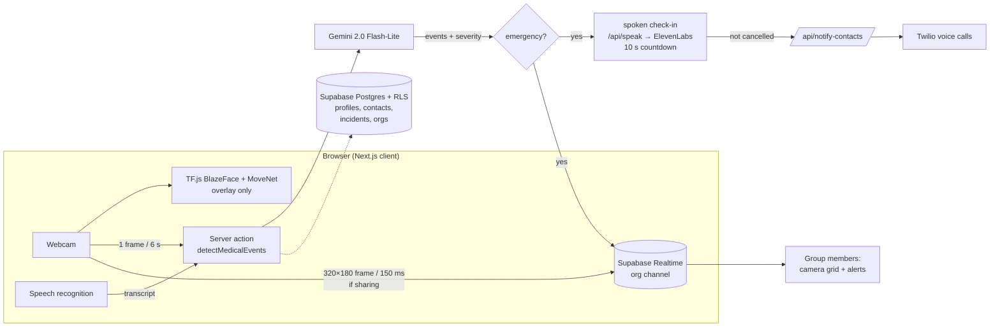

# FirstWatch

A web app that watches over someone who lives alone. It checks their webcam and what they say for signs of a medical emergency (stroke, fall, cardiac event, seizure). If it finds one and the person does not answer a spoken check-in within 10 seconds, it phones their emergency contacts with their medical details and address. Built at HackTJ 2026.

<!-- TODO(Max): add a screenshot of the Live Feed page (pose overlay + countdown) and of the family camera grid. There are no FirstWatch screenshots or demo video in the repo yet. -->

## What it does

1. **Onboarding.** The user signs up (Supabase Auth, email and password) and saves a medical profile (age, blood type, allergies, conditions, medications) and emergency contacts.
2. **Live Feed.** In the browser, TensorFlow.js runs BlazeFace (face box) and MoveNet (body pose) over the webcam as an on-screen overlay. Every 6 seconds a 320×180 frame, plus the speech-to-text transcript so far, is sent to Gemini (`gemini-2.0-flash-lite`), which labels it `STROKE`, `FALL`, `CARDIAC`, `SEIZURE`, `DISTRESS` or `NORMAL` with a severity.
3. **Emergency sequence.** When Gemini flags an event as dangerous, the app stops sending frames, sounds an alarm, speaks a check-in out loud (ElevenLabs, with the browser's built-in voice as a fallback), starts a 60-second audio recording, logs the incident, and starts a 10-second countdown. Pressing "I Am Okay" or saying "I'm okay" cancels it.
4. **Calls.** If nobody cancels, Twilio phones each emergency contact (for HIGH or CRITICAL severity) and a configured "EMS" number with a spoken message giving the event, the medical profile and the location (browser GPS, turned into an address with OpenStreetMap).
5. **Family groups.** Users can form a group with an invite code. Members who turn on sharing stream low-resolution camera frames to each other over Supabase Realtime, shown as a live grid, and every member's browser gets an alert when anyone in the group has an emergency.
6. **History and dashboard.** Past incidents, contacts, and a summary of the profile.

## How it works



- **Next.js 15 App Router + React 19 + TypeScript**, Tailwind and shadcn/ui.
- **Supabase** for auth, Postgres (with row-level security so group members can see each other's incidents: `supabase-migration.sql`, `supabase-fix-rls.sql`) and Realtime broadcast channels for camera frames and alerts.
- **The emergency decision is made by a prompted vision-language model**, not a trained classifier. The pose and face models draw the overlay but are not used in the decision.
- **Tests:** 14 unit tests (Node's built-in test runner) for the Realtime, member-feed, local-cache, TF backend and password-reset helpers.

## Built on HawkWatch

FirstWatch started from the codebase of [HawkWatch](https://devpost.com/software/hawkwatch) ([nf-projects/Hawkwatch](https://github.com/nf-projects/Hawkwatch)), a TreeHacks 2025 security-camera project by Grace Shao, Nils Fleig, Darryl Tanzil and Alex Li.

## Run it locally

Needs Node 20+, a Supabase project, and a Gemini API key.

1. In the Supabase SQL editor, run `supabase-migration.sql`, then `supabase-fix-rls.sql`. In Database → Replication, enable Realtime for the `org_members` table.
2. Copy `.env.example` to `.env.local` and fill it in:

   | Variable | Needed for |
   |---|---|
   | `NEXT_PUBLIC_SUPABASE_URL`, `NEXT_PUBLIC_SUPABASE_ANON_KEY` | everything |
   | `GOOGLE_API_KEY` | Live Feed detection (Gemini) |
   | `TWILIO_ACCOUNT_SID`, `TWILIO_API_KEY_SID`, `TWILIO_API_KEY_SECRET`, `TWILIO_PHONE_NUMBER` | phone calls (skipped if unset) |
   | `EMS_PHONE_NUMBER` | the number the "EMS" call goes to (can be turned off in settings) |
   | `ELEVENLABS_API_KEY` | natural voice (falls back to the browser voice) |
   | `NEXT_PUBLIC_SITE_URL` | password-reset links |
   | `OPENAI_API_KEY` | only the leftover HawkWatch chat/summary pages |

3. Run:

   ```bash
   npm ci
   npm run dev     # http://localhost:3000
   npm test        # unit tests
   npm run build
   ```

The Live Feed needs a browser with the Web Speech API (Chrome or Safari) and camera permission.

## Limitations

This is an overnight hackathon prototype, not a medical device.

- Detection is a single prompt to a general vision-language model on one frame every 6 seconds. It has not been evaluated on any dataset, so there are no accuracy numbers.
- `/api/notify-contacts` does not check who is calling it, and group invite codes are readable by any signed-in user. Both need fixing before real use.
- Incident audio is stored as a browser `blob:` URL, so it cannot be played back after a reload or on another device.
- The "EMS" call goes to whatever number is configured, not to emergency services.
- The landing page's heart-rate and SpO₂ numbers and the "Robert's Morning" timeline are illustrations, not measured data.
